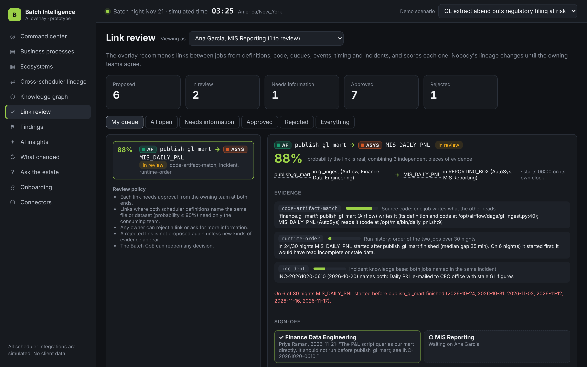

# Batch Intelligence Overlay (prototype)

An AI **system of engagement** that sits on top of the schedulers an enterprise already runs
(Control-M, AutoSys, Airflow, Azure Data Factory and others). It doesn't replace any of them.
It reads from all of them, puts every job into one model, finds the dependencies *between*
schedulers, maps jobs to business processes and SLAs, and adds intelligence on top:

* **Link recommender with owner review**: scheduler definitions, mined job code (files, tables,
  MQ queues, events), timing in run history and past incidents each contribute evidence. The
  evidence is combined into a probability (noisy-OR). Each recommended link goes to the teams that
  own both ends, who approve it, reject it or ask a question. Nobody's lineage changes without them.
* **Source mining**: the overlay reads the code each job runs (JCL, shell, Airflow DAGs, ADF
  pipelines and notebooks). It finds the files, tables, hosts, e-mails, API calls and credentials
  that no scheduler definition mentions, and cites the file and line for each.
* **Auto-curated knowledge graph**: 16 node types and 18 relation types, rebuilt from source on
  every sync. Every edge records its provenance (definition, code, runtime, catalogue, approved,
  proposed, derived, incident). Diffing nightly snapshots gives a changelog with no hand
  maintenance.
* **Static and runtime findings**: dead conditions, missing and redundant dependencies, silent
  failures, plaintext secrets, single points of failure, data leaving the bank, sensors that poke
  for hours, durations growing toward the SLA, queueing delays, stale reads, and where minutes
  saved move the SLA.
* **Business process view**: each process is defined once by its outcome (anchor jobs and an
  SLA). Its full supply chain across every scheduler is derived from the lineage graph.
* **SLA forecasting**: Monte Carlo simulation over 30 nights of history, propagated through
  the cross-scheduler graph, gives P50/P90 finish times and a breach probability.
* **Anomaly detection**: robust z-scores on durations, with business-aware severity. A slow job
  that isn't on an at-risk critical path is suppressed, not paged.
* **Impact and root-cause hints**: downstream blast radius by scheduler, process and service,
  plus ranked upstream hypotheses (failures, slow jobs, shared resources).
* **Knowledge base (RAG)**: similar past incidents and their fixes.
* **Ask the estate**: natural-language Q&A, using Claude by default and grounded through 17 tools.
  It answers layered questions (job → file → host → process), questions scoped to one ecosystem,
  what-if outages, and what the code sends outside the scheduler.
* **Onboarding sandbox**: paste a JIL, Control-M JSON or Airflow export. The real adapter parses it,
  checks it, and proposes links to the live estate without changing anything.
* **Human-in-the-loop actions**: an approved action is translated into each scheduler's native
  command (`ctm run`, `sendevent`, `airflow tasks clear`, `az datafactory`) and audited.

> **All integrations are simulated.** Each simulator emits payloads in its scheduler's real
> API format (Control-M Automation API JSON, AutoSys JIL, Airflow REST, ADF management API).
> The adapters parse those exactly as they would at a client. There is no client data.

## Run it

**Containers (recommended)**

```bash
cp .env.example .env          # optional: add ANTHROPIC_API_KEY for conversational answers
docker compose up --build     # open http://localhost:8080
```

**Local dev**

```bash
cd backend && pip install -e ".[dev]" && uvicorn batchiq.api.app:app --reload --port 8000
cd frontend && npm install && npm run dev        # http://localhost:5173
```

## Testing (in the cloud, not on a laptop)

Every push and pull request runs the whole suite on GitHub's runners (`.github/workflows/ci.yml`), so nothing
needs to run on a local machine:

| Job | What it proves |
|---|---|
| Backend tests | ruff, then about 90 tests in parallel (pytest-xdist): miner per dialect, recommender and review workflow, graph schema and provenance, every finding rule, API contract, offline assistant routing |
| Frontend | type check and production build |
| End-to-end | `docker compose up` of the real images, then Playwright in Chromium: every page renders with no console errors or 5xx, and the demo flows work |
| Image | the API image starts as the non-root user Kubernetes uses, and answers |
| Kubernetes | the base and the AWS, Azure and GCP overlays render, and the base deploys and answers on a kind cluster |
| Compose | the compose file is valid in every profile |

`make ci-status` lists the runs for your branch. To run the same things somewhere with Docker: `make test`,
`make up && make e2e`.

## Screens

| Screen | What it answers |
|---|---|
| Command center | What is happening tonight, and which business outcomes are at risk |
| Business processes | One process end to end across schedulers, with its SLA forecast |
| Ecosystems | One scheduler as its teams see it: folders, boxes, DAGs or pipelines, its graph, hosts, data and findings |
| Cross-scheduler lineage | The whole estate as one graph |
| Knowledge graph | Any job, file, table, host, e-mail or process, its relations and their provenance, and the paths between two things |
| Link review | The recommended links, their evidence, who must sign off, and what approval changes. Switch persona to act as any owner |
| Findings | Static and runtime findings, with evidence and a recommendation |
| What changed | Definition changes between syncs, with ticket and author, and the links they opened |
| Ask the estate | Natural-language questions, grouped by kind |
| Onboarding | What each connector delivered, and a sandbox for a new export |



## Demo scenarios

Switch scenarios from the top bar. Each one is a deterministic batch night:

| Scenario | Story |
|---|---|
| `gl-extract-abend` (default) | A Control-M mainframe abend (S0C7) silently pushes two Airflow-run processes, the GL close and the regulatory liquidity filing, toward SLA breach. A slow AutoSys job is shown as harmless. |
| `warehouse-contention` | Nothing fails, but a Snowflake warehouse slowdown in Airflow drifts the SLAs. |
| `healthy-night` | Baseline. Everything is on track. |

See [docs/DEMO_SCRIPT.md](docs/DEMO_SCRIPT.md) for a 10-minute walkthrough.

## LLM providers

Set `LLM_PROVIDER`:

| Value | Behaviour |
|---|---|
| `auto` (default) | Claude if `ANTHROPIC_API_KEY` is set, otherwise offline |
| `anthropic` | Claude via the official SDK (`LLM_MODEL`, default `claude-opus-5-5`) with adaptive thinking and server-side refusal fallback. For Bedrock, Vertex AI or Foundry, swap in the SDK's platform client. |
| `openai_compatible` | Any self-hosted open-source model behind an OpenAI-compatible endpoint (vLLM, Ollama, TGI, LiteLLM). `docker compose --profile local-llm up` starts Ollama. |
| `offline` | Deterministic, rule-based answers from the same tools. No network needed. |

## Deploy (cloud-agnostic)

Plain Kubernetes manifests with Kustomize. Only the ingress differs per cloud:

```bash
kubectl apply -k deploy/k8s/overlays/aws     # EKS + ALB
kubectl apply -k deploy/k8s/overlays/azure   # AKS + app routing
kubectl apply -k deploy/k8s/overlays/gcp     # GKE + internal GCE ingress
```

## Layout

```
backend/batchiq/
  domain/          unified, vendor-neutral model (Job, Dependency, JobRun, BusinessProcess…)
  adapters/        one package per scheduler: simulator (native API) + adapter (translator)
  core/            store (repository port), lineage graph, business mapping, baselines
  discovery/       source repository port and the source-code miner (rules per dialect)
  linking/         evidence strategies, link recommender (noisy-OR), review workflow and policy
  knowledge/       ontology, property graph, graph builder, snapshot diff
  analysis/        static and runtime finding rules
  views/           read models for the screens: ecosystems, knowledge graph, links, findings, changelog, onboarding
  intelligence/    live state, Monte Carlo forecast, insight engine (anomaly/impact/RCA/recs), knowledge base
  llm/             provider abstraction: Anthropic, OpenAI-compatible, factory
  assistant/       tools over the estate, offline provider, assistant orchestrator
  simulation/      ground-truth estate (61 jobs), job source code, change history, scenarios, run history
  catalog/         business process catalogue, people directory, sample exports (client-specific config)
  api/             FastAPI app and routes
frontend/src/      React + TypeScript console (React Flow lineage, SVG charts)
deploy/k8s/        Kustomize base + AWS/Azure/GCP overlays
docs/              architecture and demo script
```

Architecture details: [docs/ARCHITECTURE.md](docs/ARCHITECTURE.md).
